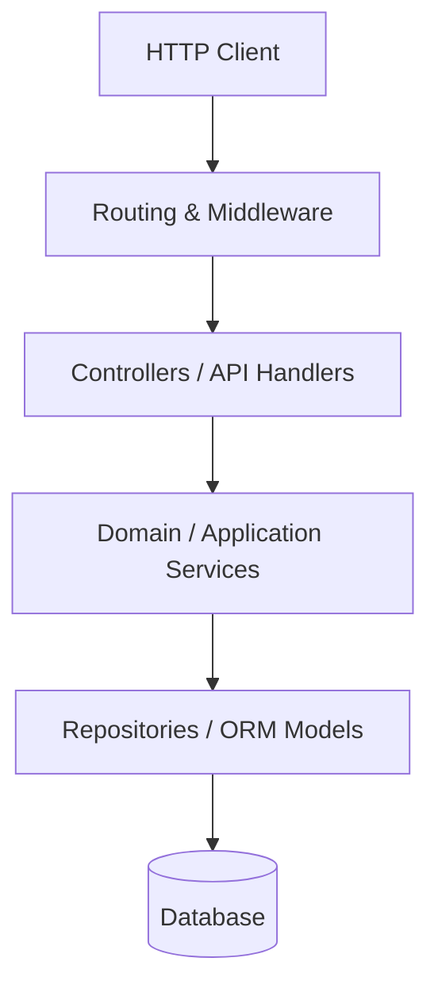

### Application Architecture Overview
- **Framework & Runtime**: [e.g. Laravel 11 / PHP 8.3 / Vue 3]
- **Architecture Pattern**: [e.g. Layered MVC / Hexagonal / Action-Domain-Responder]
- **Primary Entrypoints**: `public/index.php`, `routes/api.php`

### Module & Layer Map

### Key Architectural Findings
- **Strengths**: [e.g. Strict validation through Form Requests, clear service layer separation]
- **Boundary Violations**: [e.g. Controller `BillingController` executes raw payment logic directly]
- **Design Pattern / Complexity Improvements**: [e.g. Replace cascading tax `switch` with Strategy Pattern]
- **Dead Code Candidates**: [e.g. Unreferenced route group `/legacy/v1`]
