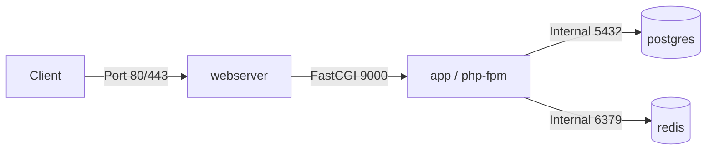

### Container Infrastructure Overview
- **Base Images**: [e.g., `php:8.3-fpm-alpine`, `node:20-alpine`]
- **Multi-Stage Build**: [Yes / No]
- **Total Services**: [Count] (e.g., `app`, `webserver`, `db`, `redis`)

### Service Topology

### Optimization & Hardening Findings
- **Image Size Improvements**: [e.g. Multi-stage build can reduce final image by ~350MB]
- **Security Recommendations**: [e.g. Add non-root user `appuser`]
