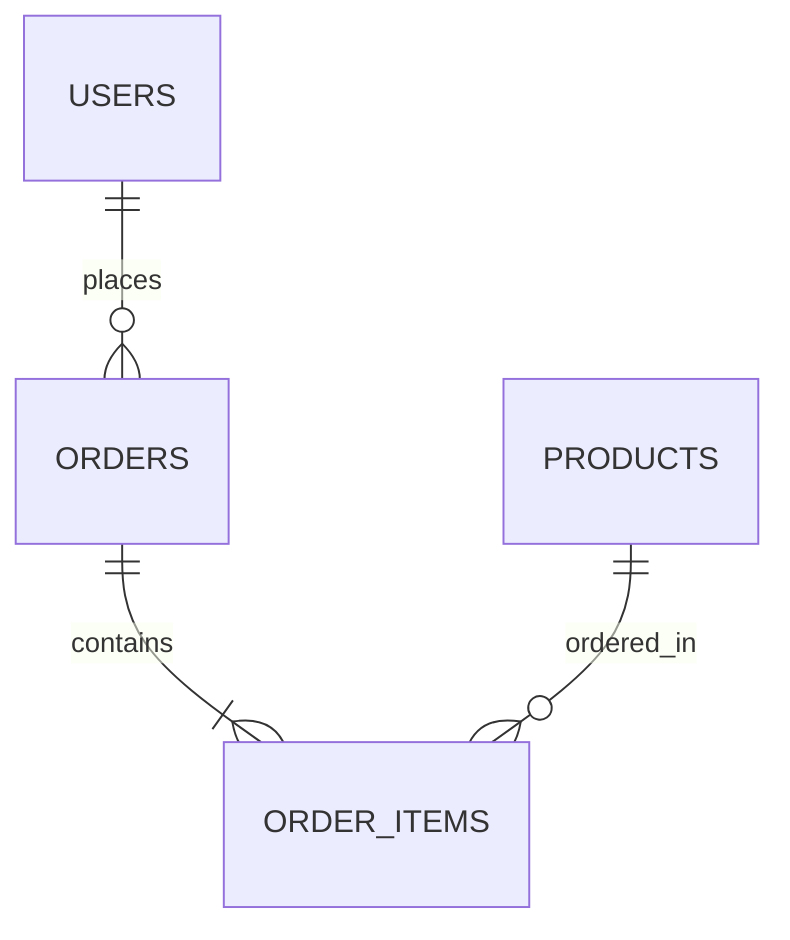

### Database Schema & Model Overview
- **ORM / Driver**: [e.g., Eloquent / PostgreSQL]
- **Total Entities**: [Count]
- **Key Domain Clusters**: [Identity, Billing, Catalog]

### Entity-Relationship Diagram

### Entity Catalog
- **`users`** (`App\Models\User`): Core user entity (fields: `id`, `email`, `role`, `created_at`).
- **`orders`** (`App\Models\Order`): Customer orders (fields: `id`, `user_id`, `status`, `total_cents`).
