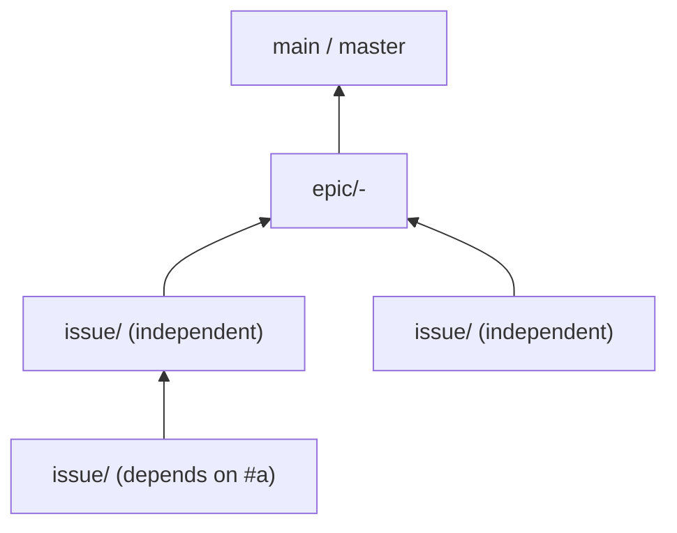

# Branching Strategies

Reference for multi-strategy branching topologies, parent-branch selection, branch
naming rules, stacked-chain hygiene, and the merge-vs-rebase decision. Read this file
when selecting a branching strategy, choosing a parent base ref, creating/naming
branches, or propagating updates across branches.

## Branch Strategy Selection

Select the strategy that matches the repository's release cadence, concurrency, and
dependency structure. Do not assume a single strategy fits every task.

| Branch Strategy | Best for | Characteristics |
|----------|----------|-----------------|
| **Mainline / Trunk Streaming** | CI/CD, rapid integration, independent changes | Short-lived feature branches cut from and merged directly into `main`/`master` (or direct trunk commits guarded by feature flags) |
| **GitHub Flow** | Continuous deployment, small-to-medium teams | One mainline branch; short-lived feature branches; PR per change; deploy from mainline |
| **Git Flow** | Releases on a fixed cadence | `develop` + `feature/*` + `release/*` + `hotfix/*`; `main`/`master` holds only released code |
| **Epic-Tree & Dependency-Stacked** | Multi-issue epics with parallel and dependent work | Long-lived `epic/<id>-<slug>` off `main`/`master`; independent `issue/*` branches off the epic; dependent `issue/*` branches stacked off upstream dependency branches |

### Decision heuristic

```text
IF work is a multi-issue epic or has explicit issue dependencies → Epic-Tree / Dependency-Stacked
ELSE IF releases follow a fixed versioned cadence → Git Flow
ELSE IF continuous delivery with short-lived PRs → GitHub Flow
ELSE IF CI/CD with rapid trunk integration / feature flags → Mainline / Trunk Streaming
```

## Epic-Tree & Dependency-Stacked Branching

Use this topology when breaking a larger initiative into an epic branch and multiple
child issue branches—some independent, others blocked on upstream issues:



### Parent Selection Rules

| Branch role | Parent base ref | Merge target |
|---|---|---|
| Epic integration branch (`epic/<id>-<slug>`) | `origin/<default-branch>` (`main` / `master`) | `<default-branch>` |
| Independent sub-issue (`issue/<a-slug>`, `issue/<b-slug>`) | `epic/<id>-<slug>` (or `origin/epic/<id>-<slug>`) | `epic/<id>-<slug>` |
| Dependent sub-issue (`issue/<c-slug>`) | Upstream dependency branch (`issue/<a-slug>`) | Upstream dependency branch (or `epic/<id>-<slug>` once upstream lands) |

Verify parent lineage before opening a PR by passing the intended parent to `@scripts/branch_base_check.sh`:

```bash
bash <skill-dir>/scripts/branch_base_check.sh --base <parent-ref> --head <branch>
```

### Cascading Rebase & Merge-Up Hygiene

1. **Merge completed children up the chain**: Once `issue/<a-slug>` is approved, merge it into `epic/<id>-<slug>` (or retarget `issue/<c-slug>` onto `epic/<id>-<slug>` after updating `issue/<c-slug>`).
2. **Propagate upstream updates down stacked chains**: When `issue/<a-slug>` receives new commits or review fixes, update `issue/<c-slug>` promptly so conflicts stay small.
3. **Retarget PR bases explicitly**: Ensure each PR's base branch in GitHub matches its actual parent branch (`epic/<id>-<slug>` or upstream `issue/*`) rather than defaulting blindly to `main`/`master`.

### Squash vs. Merge-Commit Trade-Offs in Stacked Chains

| Integration style | Effect on downstream stacked branches | Recommended recovery / workflow |
|---|---|---|
| **Merge commit (`--no-ff`)** | Preserves shared commit SHAs between parent and child | Child branch can `git merge <parent>` or `git rebase <parent>` cleanly without duplicate-commit conflicts |
| **Squash merge** | Rewrites upstream commits into a single new SHA on the parent | Plain `git rebase <parent>` replays already-landed upstream commits as conflicts; use `git rebase --onto <new-parent> <old-parent-tip> <child>` instead |

Prefer merge commits (or fast-forward merges) when integrating intermediate stacked branches into an active `epic/<id>-<slug>`, and reserve squash-merging for the final `epic/<id>-<slug>` → `main`/`master` landing—or plan explicit `--onto` rebases whenever an intermediate branch is squashed.

### Handling Upstream Base Updates

When `main`/`master` advances while an epic is in flight:

1. Sync `epic/<id>-<slug>` with `origin/<default-branch>` (prefer `git merge origin/<default-branch>` if the epic is shared so collaborators' branches keep shared history).
2. Cascade the updated `epic/<id>-<slug>` into open `issue/*` child branches.
3. Cascade updates from each upstream `issue/*` branch down into any dependent `issue/*` branches.
4. Re-run `branch_base_check.sh --base <parent-ref>` and test suites at each affected level before merging up.

## Branch Naming Rules

Enforce before branch creation. No special characters (`git` allows most, but
naming rules keep things safe and greppable).

| Branch type | Pattern | Example |
|-------------|---------|---------|
| Epic | `epic/<id>-<slug>` | `epic/400-git-unification` |
| Issue / Sub-issue | `issue/<id>-<slug>` | `issue/402-branch-strategies` |
| Feature | `feat/<ticket>-<slug>` | `feat/tic-1234-oauth-login` |
| Fix | `fix/<ticket>-<slug>` | `fix/tic-4567-null-jwt` |
| Hotfix | `hotfix/<slug>` | `hotfix/logout-timeout` |
| Release | `release/<version>` | `release/v2.1.0` |
| Chore | `chore/<slug>` | `chore/dep-upgrade` |

Rules:
- Use hyphens between words, no spaces, no `/` in the slug portion itself.
- Include the ticket/issue ID when one exists or is provided — it makes cross-referencing trivial.
- Do not name branches after the person; name them after the work.

## Merge vs Rebase

See `@references/merge-strategies.md` for the full breakdown of
merge types (explicit, fast-forward, rebase, squash) and when to use each.

**Rule: Merge (public), Rebase (private).**

| Scenario | Rebase | Merge |
|----------|--------|-------|
| Update feature branch from main | ✅ | ❌ |
| Integrate feature into main | ❌ | ✅ |
| Clean local commits (squash WIP) | ✅ | ❌ |
| Shared branch | ❌ | ✅ |
| Public history | ❌ | ✅ |
| Private branch | ✅ | Either |

## Common Operations

### Update a feature branch

```bash
git fetch origin && git rebase origin/main
```

Conflicts: `git add <files> && git rebase --continue` (**always** ask user).
Abort: `git rebase --abort`.

### Interactive rebase (clean history)

```bash
git rebase -i HEAD~5   # edit last 5 commits
```

Commands: `pick` keep, `reword` edit message, `edit` amend, `squash` merge
into previous, `fixup` merge discarding message, `drop` remove.

### Squash all local commits

```bash
git rebase -i $(git merge-base HEAD main)
```

### Compare branch to base (PR preparation)

```bash
# Token-efficient divergence, commit list, and file diffs
bash @scripts/branch_diff.sh [base_branch]
```

### Branch overview & cleanup

```bash
# List local/remote branches with upstream tracking and merged status
bash @scripts/branches.sh

# Prune stale tracking refs and delete merged local branches (requires confirmation)
bash @scripts/branches.sh --prune --delete-merged
```

### Push safely

```bash
git push --force-with-lease   # never plain --force on shared branches
```

## Safety

- NEVER rebase shared/public branches.
- NEVER force-push without `--force-with-lease` and user confirmation.
- Recover from botched rebases with `git rebase --abort` or the reflog (see
  `@references/cli-commands.md`).
