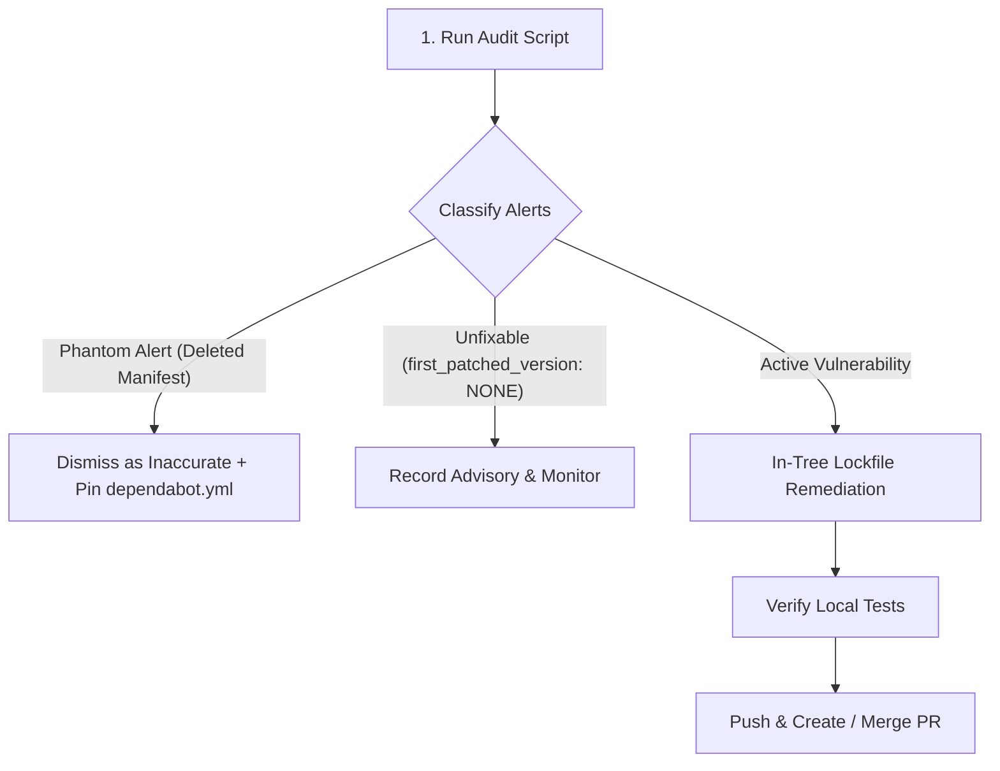

# GitHub Dependabot Skill

Standard operating procedures for dependency vulnerability monitoring, alert classification, lockfile remediation, Dependabot pull request management, and configuration maintenance.

## Workflow Overview



## Shared Resources

Run bundled helper scripts relative to this skill's root directory (`<skill-dir>/scripts/...` e.g. `.github/skills/github-dependabot/scripts/...`):

| Resource | Location | Invocation Syntax | Purpose |
|----------|----------|-------------------|---------|
| Repo alert audit | `@scripts/audit_repo_alerts.py` | `python3 <skill-dir>/scripts/audit_repo_alerts.py --repo <owner/repo> [--base master] [--json] [--fetch]` | Dependabot + code-scanning triage in one call. Classifies each alert against the default branch, separates **phantom** alerts from real ones, flags `first_patched_version: NONE`, and outputs precise dismissal commands. Read-only. |

---

## 1. Alert Monitoring & Triage

Always start alert reviews by running the bundled audit script to get a clean classification snapshot.

### Step 1: Run the Audit Script

```bash
python3 .github/skills/github-dependabot/scripts/audit_repo_alerts.py --repo <owner/repo> --base master
```

### Step 2: Classify Findings

1. **Active Alerts (Real Manifests)**
   - The manifest path exists on the base branch (`origin/master`).
   - If a patched version exists (`fixed_in`), proceed to **Section 2: Automated Remediation Flow**.

2. **Phantom Alerts (Deleted or Moved Manifests)**
   - Dependabot auto-discovers manifests repo-wide and retains historical alerts for files that were moved, renamed, or deleted (e.g. old `.bk` files or deleted trees).
   - **Dismissal Procedure**: Dismiss phantom alerts as `inaccurate` using the exact `gh` command emitted by `audit_repo_alerts.py`:
     ```bash
     gh api --method PATCH repos/<owner/repo>/dependabot/alerts/<alert_number> \
       -f state=dismissed -f dismissed_reason=inaccurate \
       -f dismissed_comment="Manifest absent from master; live path is <live_manifest>"
     ```
     *(Note: `dismissed_comment` is capped at 280 characters by the GitHub API).*
   - **Root Cause Prevention**: Dismissing a phantom alert does not prevent Dependabot auto-discovery from re-opening it on future scans. Update `.github/dependabot.yml` to pin monitored directories.

3. **Unfixable Advisories (`first_patched_version: NONE`)**
   - Upstream vendor has not released a patched version yet.
   - Do not churn or create empty PRs. Document the GHSA ID in the triage issue/discussion and schedule periodic re-audits.

---

## 2. Automated Remediation Flow

When an active vulnerability has a known fix, perform in-tree lockfile updates and verify locally before pushing changes.

### Ecosystem Lockfile Bump Recipes

- **Python (`uv`)**:
  ```bash
  # Target single package update
  uv lock -P <package_name>

  # Full lockfile upgrade (if required)
  uv lock -U
  ```
- **Node.js (`npm` / `pnpm` / `yarn`)**:
  ```bash
  # npm
  npm update <package_name> --package-lock-only

  # pnpm
  pnpm update <package_name>

  # yarn
  yarn upgrade <package_name>
  ```
- **Ruby (`bundler`)**:
  ```bash
  bundle update <package_name> --conservative
  ```
- **Go (`go.mod`)**:
  ```bash
  go get <package_name>@latest
  go mod tidy
  ```

### Local Verification & Validation

Before committing dependency updates:
1. **Run Local Test Suite**: Ensure no breaking changes or regressions were introduced.
2. **Verify Lockfile Integrity**: Confirm git diff shows minimal, targeted changes to lockfiles and manifest files.
3. **Validate Syntax & Compilation**: Run language linters or compilers (e.g., `py_compile`, `npm test`).

---

## 3. Dependabot PR Management

When reviewing automated PRs submitted by `@dependabot`:

### Evaluation Checklist
1. **Compatibility Score**: Check GitHub's compatibility score in the Dependabot PR body (based on CI outcomes across public repos).
2. **Release Notes & Changelogs**: Review linked release notes for semver breaking changes in major/minor version bumps.
3. **CI Status**: Verify all required check runs pass on the PR branch.

### Dependabot Bot Commands
Interact with Dependabot PRs by commenting directly on the PR:
- `@dependabot rebase`: Rebase the PR against base branch.
- `@dependabot recreate`: Re-create the PR from scratch with updated lockfiles.
- `@dependabot merge`: Squash and merge the PR once checks pass (if auto-merge enabled).
- `@dependabot ignore this package version`: Stop Dependabot from opening PRs for this version update.
- `@dependabot ignore this dependency`: Stop all future updates for this dependency.

---

## 4. Configuration Best Practices (`.github/dependabot.yml`)

Maintain an explicit `.github/dependabot.yml` configuration file to define package ecosystems, update schedules, and directory pinning.

### Standard Configuration Template

```yaml
version: 2
updates:
  # Python ecosystem
  - package-ecosystem: "pip" # or "uv" / "poetry" depending on tooling
    directory: "/"
    schedule:
      interval: "weekly"
    open-pull-requests-limit: 10

  # GitHub Actions ecosystem
  - package-ecosystem: "github-actions"
    directory: "/"
    schedule:
      interval: "weekly"
    open-pull-requests-limit: 5
```

### Key Principles
- **Pin Monitored Directories**: Explicitly setting `directory:` disables auto-discovery on deleted/historical paths, preventing phantom alerts.
- **Group Updates**: Group non-critical minor/patch updates to reduce PR noise.
- **Limit Open PRs**: Use `open-pull-requests-limit` to prevent PR overload.
