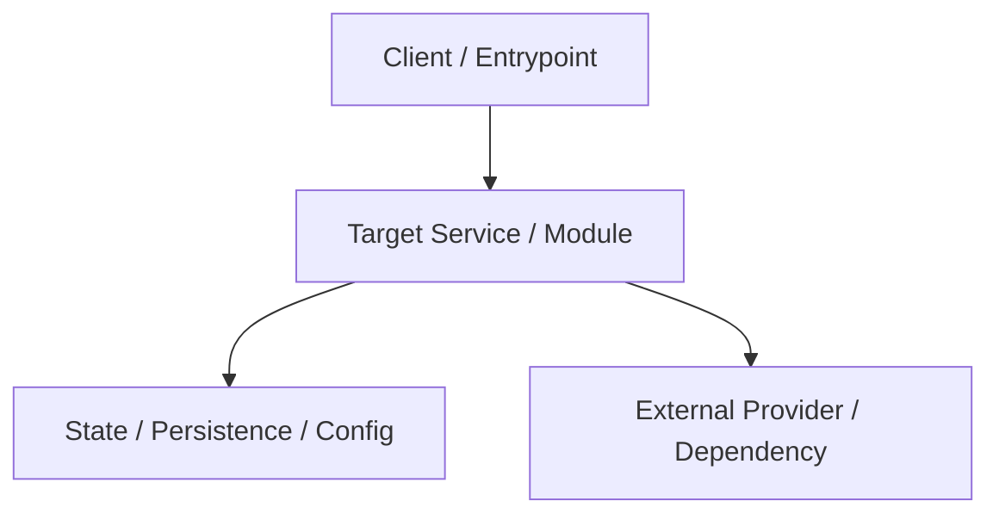

# Technical Design Spec (RFC): [System / Feature Name]

| Metadata | Details |
|---|---|
| **Author / Team** | [Author / Team] |
| **Status** | Draft | In Review | Approved | In Development | Implemented | Superseded |
| **Created Date** | YYYY-MM-DD |
| **Related ADRs** | [`ADR-000x`](../docs/adr/000x-slug.md) |
| **Target Release** | [Milestone / Release / Version] |
| **External Tracker** | [Jira / GitHub Issue Link](url) |

---

## 1. Problem Statement & Background
- **Context**: [Current state of the system, constraints, and limitations.]
- **Problem**: [What technical bottleneck, failure mode, or gap is being addressed?]
- **Why Now**: [Driver for change — scale, security, dependency deprecation, new capability.]

---

## 2. Goals & Non-Goals
- **Goals (`G-*`)**:
  - `G-001`: [Measurable technical outcome, e.g. "Eliminate N+1 queries, p95 latency < 50ms"]
  - `G-002`: [Secondary technical objective]
- **Non-Goals (`NG-*`)**:
  - `NG-001`: [Explicitly excluded architectural or operational scope]
  - `NG-002`: [Deferred capability or external dependency]

---

## 3. Architecture & Interface Contracts
### 3.1 Component Topology & Data Flow

### 3.2 Schemas & Contracts
- **Data Models**: [Schema definitions, structs, types, or configuration formats]
- **API Endpoints / CLI Commands**: [Command signatures, flags, request/response formats]
- **Invariants**: [Security isolation, secret boundaries, concurrency rules]

---

## 4. Requirements & Edge Cases
### Functional & Technical Requirements
- **`REQ-001`** [P0]: WHEN [trigger condition], the [component] SHALL [deterministic behavior].
  - [ ] Given [preconditions], when [action], then [expected system state].
  - [ ] Given [invalid input / degraded dependency], when [action], then [error handling / fallback].
- **`REQ-002`** [P1]: The [component] SHALL [behavior].

### Non-Functional Requirements (NFRs)
- **Performance**: Latency targets, memory footprint, compute bounds.
- **Security & Secrets**: Credential boundaries, sandbox isolation, least privilege.
- **Reliability & Observability**: Error budgets, structured logging, metric signals.

---

## 5. Migration, Rollout & Rollback Strategy
- **Rollout Phase**: [Feature flag gating, blue/green deployment, phased rollout]
- **Data Migration**: [Schema migrations, forward/backward compatibility considerations]
- **Rollback Procedure**: [Exact steps to reverse changes if failure occurs in production without data loss]

---

## 6. Milestones & Engineering Tasks
- **`M-001`**: [Phase 1 Title] — Exit criteria: [Verifiable test / lint pass]
  - `TSK-101`: [Task Title] (Target files: `path/to/file`, Evidence: None)
- **`M-002`**: [Phase 2 Title] — Exit criteria: [End-to-end verification]
  - `TSK-201`: [Task Title] (Target files: `path/to/file`, Evidence: None)

---

## 7. Revision Log
Append-only. Add one row per change, newest last.

| Date | Action | IDs | Evidence | Rationale |
|---|---|---|---|---|
| YYYY-MM-DD | Created RFC | G-001, NG-001, REQ-001 | None | Initial technical proposal |
