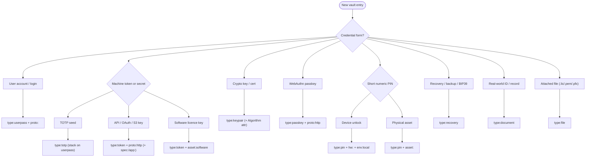

# KeePass Classification Knowledge Centre

Classify KeePass/KeePassXC entries using a flat tag taxonomy anchored on `type:`. Contextual namespaces qualify the anchor and never stand alone. Rules below are defaults unless overridden by the user for a specific entry.

## Tag Namespaces

| Namespace | Role | Valid Values |
|---|---|---|
| `type:` | **Anchor** — credential format | `userpass` `token` `keypair` `totp` `passkey` `pin` `recovery` `document` `file` |
| `env:` | Network perimeter | `cloud` `homelab` `local` |
| `proto:` | Connection protocol (stackable) | `http` `ssh` `rdp` `winrm` `gui` `console` `db` `smb` `ldap` |
| `spec:` | API / schema contract | `openai` `anthropic` `s3` `oauth2` `oidc` `smtp` |
| `app:` | Automation consumer / stack | `ssh-config` `litellm` `openhands` `dotenv` `<stack-name>` |
| `hw:` | Physical hardware target | `laptop` `server` `phone` `tablet` |
| `org:` | Ownership context | `personal` `work` `family` |
| `cat:` | Non-technical category | `finance` `media` `ident` |
| `loc:` | Physical storage location | `safe` `filing-cabinet` `wallet` |
| `asset:` | Physical asset type | `card` `vehicle` `wallet` `software` |

## Classification Flow

## Compatibility Matrix

`MUST` = required &nbsp;&nbsp; `MAY` = optional &nbsp;&nbsp; `IF ...` = conditional &nbsp;&nbsp; `✗` = MUST NOT use

| Type | `env:` | `proto:` | `spec:` | `app:` | `hw:` | `org:` | `cat:` | `loc:` | `asset:` |
|---|:---:|:---:|:---:|:---:|:---:|:---:|:---:|:---:|:---:|
| `userpass` | MUST | MUST (1+) | MAY | MAY | ✗ | MUST | MAY | ✗ | ✗ |
| `token` | MUST | IF API | IF API | MAY | ✗ | MUST | ✗ | ✗ | IF software |
| `keypair` | MUST | MAY | ✗ | MAY | ✗ | MUST | ✗ | ✗ | ✗ |
| `totp` | inherit | inherit | inherit | inherit | ✗ | inherit | inherit | ✗ | ✗ |
| `passkey` | MUST | MUST (http) | ✗ | ✗ | ✗ | MUST | ✗ | ✗ | ✗ |
| `pin` | IF device | ✗ | ✗ | ✗ | IF device | MUST | ✗ | ✗ | IF asset |
| `recovery` | IF digital | ✗ | ✗ | ✗ | IF disk | MUST | ✗ | IF physical | IF wallet |
| `document` | ✗ | ✗ | ✗ | ✗ | ✗ | MUST | MAY (ident) | MAY | IF vehicle |
| `file` | MUST | MAY | ✗ | MAY | ✗ | MUST | ✗ | ✗ | MAY (software) |

## Type Semantics & Ambiguity Resolution

- **`type:userpass` vs `hw:` vs `type:keypair`**: User accounts represent logical OS/service identities, never physical hardware (`hw:` is forbidden). Multi-protocol logins stay one entry (e.g. `proto:gui proto:rdp proto:winrm`). Store raw cryptographic keys once as `type:keypair` (with custom `Algorithm`), and reference them from `type:userpass` + `proto:ssh` entries.
- **`type:totp`**: Stacking tag added to a parent `type:userpass` entry; never standalone.
- **`type:passkey`**: Web-only (`env:cloud` or `env:homelab` + `proto:http`).
- **`type:token` (`proto:` vs `asset:software`)**: Network/API tokens take `proto:http` (and optional `spec:`/`app:`); static software activation serials take `asset:software` instead. Never combine `proto:` and `asset:` on `type:token`.
- **`type:pin`**: Static numeric code only; device PINs require `hw:` + `env:local`, asset PINs require `asset:` (never `env:cloud` or `env:homelab`).
- **`type:recovery` (`loc:` vs `env:`)**: Use `env:` for digital vault recovery codes, `hw:` for disk encryption (FileVault/BitLocker/LUKS), `loc:` for physical copies (paper/metal), and `asset:wallet` for hardware crypto seeds; combine `env:` + `loc:` if both forms exist.
- **`type:document` & `type:file`**: `document` records physical/identity data (`loc:`, `cat:ident`, `asset:vehicle`, no `env:`/`proto:`/`hw:`); `file` holds attached `.lic`/`.pem`/`.pfx`/`.ovpn` credentials (`env:` + `org:`, optional `asset:software` or `proto:`).

## Canonical Examples

| Credential | Tags |
|---|---|
| Linux server user account (for `~/.ssh/config`) | `type:userpass` `env:homelab` `proto:ssh` `proto:console` `app:ssh-config` `org:personal` |
| Windows PC account (Local / MS Account) | `type:userpass` `env:local` `proto:gui` `proto:rdp` `proto:winrm` `org:personal` |
| Managed switch admin login | `type:userpass` `env:homelab` `proto:http` `proto:ssh` `org:personal` |
| Homelab database login (Immich stack) | `type:userpass` `env:homelab` `proto:db` `app:immich` `org:personal` |
| OpenRouter / OpenAI API key | `type:token` `env:cloud` `proto:http` `spec:openai` `app:litellm` `app:openhands` `org:personal` |
| GitHub Personal Access Token | `type:token` `env:cloud` `proto:http` `org:personal` |
| VMware licence key (string) | `type:token` `env:local` `asset:software` `org:personal` |
| SSH private key (`id_ed25519`) | `type:keypair` `env:homelab` `proto:ssh` `org:personal` |
| Google account + MFA seed | `type:userpass` `type:totp` `env:cloud` `proto:http` `org:personal` |
| GitHub passkey | `type:passkey` `env:cloud` `proto:http` `org:personal` |
| Bank card PIN | `type:pin` `asset:card` `org:personal` |
| Tablet unlock PIN | `type:pin` `hw:tablet` `env:local` `org:family` |
| AWS MFA backup codes | `type:recovery` `env:cloud` `org:work` |
| Laptop FileVault / LUKS recovery key | `type:recovery` `env:local` `hw:laptop` `org:personal` |
| BIP39 seed (physical copy) | `type:recovery` `loc:safe` `asset:wallet` `org:personal` |
| Passport / National Insurance record | `type:document` `loc:safe` `cat:ident` `org:personal` |
| VMware licence file (`.lic`) | `type:file` `env:homelab` `asset:software` `org:personal` |

## Reference Routing

| Need | Reference | Load When |
|---|---|---|
| Custom attribute schemas for automation | `@references/custom-attributes-automation.md` | Configuring `ssh-config`, LiteLLM/OpenAI, `.env` hydration (`ENV_VAR`/`ENV_MAP`), or `type:keypair` `Algorithm` fields |
