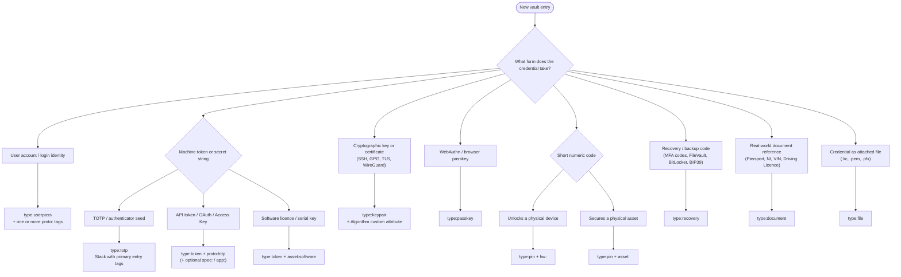

# KeePass Classification Skill

Classify KeePass entries using a flat tag taxonomy anchored on `type:`. All
other tags add context to the anchor — they do not stand alone.

These rules are **defaults, not absolutes**. Apply them unless the user
explicitly overrides a rule for a specific entry.

---

## Tag Namespaces

| Namespace | Role | Valid values |
|-----------|------|-------------|
| `type:` | **Anchor** — credential format | `userpass` `token` `keypair` `totp` `passkey` `pin` `recovery` `document` `file` |
| `env:` | Network perimeter | `cloud` `homelab` `local` |
| `proto:` | Connection protocol (stackable) | `http` `ssh` `rdp` `winrm` `gui` `console` `db` `smb` `ldap` |
| `spec:` | API / schema contract | `openai` `anthropic` `s3` `oauth2` `oidc` `smtp` |
| `app:` | Automation consumer / stack | `ssh-config` `litellm` `openhands` `dotenv` `<stack-name>` |
| `hw:` | Physical hardware target | `laptop` `server` `phone` `tablet` |
| `org:` | Ownership context | `personal` `work` `family` |
| `cat:` | Non-technical category | `finance` `media` `ident` |
| `loc:` | Physical storage location | `safe` `filing-cabinet` `wallet` |
| `asset:` | Physical asset type | `card` `vehicle` `wallet` `software` |

---

## Classification Flow

Determine `type:` first, then apply the contextual tags defined in the rules below.



---

## Type Rules

### `type:userpass`

Represents a **user account or identity entity** (e.g. a Linux system user, a
Windows local/Microsoft account, a network switch admin account, or a web/database
user). User accounts are logical identities decoupled from physical hardware and
may be accessed across multiple protocols using the same underlying credentials.

- `env:` — MUST include
- `proto:` — MUST include **one or more** protocols supported by this account (e.g. `proto:gui` `proto:rdp` `proto:winrm` for a Windows account, `proto:ssh` `proto:console` for a Linux user, or `proto:http` `proto:ssh` for a network switch)
- `org:` — MUST include
- `app:` — MAY include to target config generators (e.g. `app:ssh-config` to include this user account in `~/.ssh/config`, or `app:<stack>` for `.env` extraction)
- `cat:` — MAY include for non-technical grouping
- `hw:`, `loc:`, `asset:` — MUST NOT include (accounts belong to OS/service domains, not physical chassis)

**Example (Linux host user):** `type:userpass` `env:homelab` `proto:ssh` `proto:console` `app:ssh-config` `org:personal`  
**Example (Windows account):** `type:userpass` `env:local` `proto:gui` `proto:rdp` `proto:winrm` `org:personal`  
**Example (Network switch):** `type:userpass` `env:homelab` `proto:http` `proto:ssh` `org:personal`  
**Example (Database login):** `type:userpass` `env:homelab` `proto:db` `app:immich` `org:personal`

---

### `type:token`

Programmatic secrets: API tokens, Bearer tokens, OAuth/S3 key pairs, software licence keys.

- `env:` — MUST include
- `org:` — MUST include
- `proto:http` — MUST include IF the token authenticates to a network/HTTP API
- `spec:` — SHOULD include IF the token conforms to a standard API schema (e.g. `spec:openai`, `spec:anthropic`, `spec:s3`, `spec:oauth2`)
- `app:` — MAY include to register with automation consumers (e.g. `app:litellm`, `app:openhands`, `app:traefik`)
- `asset:software` — MUST include IF the token is a static software serial or licence key; use INSTEAD OF `proto:` and `spec:`, not alongside them
- `hw:`, `loc:` — MUST NOT include

**Example (OpenAI-compatible key):** `type:token` `env:cloud` `proto:http` `spec:openai` `app:litellm` `org:personal`  
**Example (Licence key):** `type:token` `env:local` `asset:software` `org:personal`

---

### `type:keypair`

Standalone cryptographic key material: SSH private/public keys, GPG keys, TLS certificates, WireGuard keypairs.

*Note on SSH:* `type:keypair` represents the cryptographic key itself (e.g. `id_ed25519`), stored once. Individual host logins that authenticate using this key are represented as `type:userpass` + `proto:ssh` entries referencing the key via `SSH_IdentityFile` or `{REF:...}`.

- `env:` — MUST include
- `org:` — MUST include
- Custom attribute `Algorithm` — MUST include (e.g. `Ed25519`, `RSA`, `ECDSA`, `Curve25519`)
- `proto:` — MAY include IF bound to a single protocol (`proto:ssh`, `proto:http`); omit for protocol-agnostic keys like GPG signing keys
- `hw:`, `asset:`, `loc:`, `cat:` — MUST NOT include

**Example (SSH keypair):** `type:keypair` `env:homelab` `proto:ssh` `org:personal`  
**Example (GPG keypair):** `type:keypair` `env:local` `org:personal`

---

### `type:totp`

Base32 TOTP authenticator seed. This is a **stacking type** — it is added to an
existing `type:userpass` entry, never used in isolation.

- Stack with whatever tags the parent `type:userpass` entry carries
- MUST NOT appear as a standalone entry without a primary type
- `loc:`, `asset:`, `hw:` — MUST NOT include

**Example:** `type:userpass` `type:totp` `env:cloud` `proto:http` `org:personal`

---

### `type:passkey`

WebAuthn native credential managed by the browser or vault.

- `env:` — MUST include (`cloud` or `homelab` only — passkeys are web-only)
- `proto:http` — MUST include
- `org:` — MUST include
- `hw:`, `asset:`, `loc:`, `cat:` — MUST NOT include

**Example:** `type:passkey` `env:cloud` `proto:http` `org:work`

---

### `type:pin`

Short, static, numeric-only code bound to a specific physical device or asset.

- `org:` — MUST include
- IF unlocking a physical device: MUST include `hw:` + `env:local`
- IF securing a physical asset: MUST include `asset:`
- `proto:`, `spec:`, `app:` — MUST NOT include
- `env:cloud`, `env:homelab` — MUST NOT include

**Example (Bank card):** `type:pin` `asset:card` `org:personal`  
**Example (Tablet unlock):** `type:pin` `hw:tablet` `env:local` `org:family`

---

### `type:recovery`

Break-glass secrets: MFA backup codes, FileVault / BitLocker recovery keys, BIP39 seeds.

- `org:` — MUST include
- IF the secret recovers a digital account or encrypted drive: include `env:` (`cloud` or `local`)
- IF recovering hardware-bound disk encryption (FileVault, BitLocker, LUKS): MAY include `hw:`
- IF the seed physically exists in the real world (etched metal, printed paper): include `loc:` instead of (or alongside) `env:`
- IF recovering a physical crypto device: include `asset:wallet`
- `proto:`, `cat:` — MUST NOT include

**Example (AWS MFA backup):** `type:recovery` `env:cloud` `org:work`  
**Example (Laptop FileVault):** `type:recovery` `env:local` `hw:laptop` `org:personal`

---

### `type:document`

Text records of real-world identifiers: passports, National Insurance numbers,
VINs, driving licences.

- `org:` — MUST include
- `loc:` — SHOULD include to record where the physical document lives
- `cat:ident` — SHOULD include for government or identity documents
- `asset:vehicle` — MAY include IF the entry is a VIN or V5C logbook record
- `env:`, `proto:`, `hw:` — MUST NOT include (documents do not execute on networks or hardware)

**Example (Passport):** `type:document` `loc:safe` `cat:ident` `org:personal`

---

### `type:file`

Credential delivered as an attached binary or text file (`.lic`, `.pem`, `.pfx`, `.ovpn`).

- `env:` — MUST include
- `org:` — MUST include
- `asset:software` — SHOULD include IF it is a licence file
- `proto:` — MAY include IF the file is a certificate/config for a specific protocol
- `hw:`, `loc:` — MUST NOT include

**Example (VMware licence file):** `type:file` `env:homelab` `asset:software` `org:personal`

---

## Compatibility Matrix

`MUST` = required &nbsp;&nbsp; `MAY` = optional &nbsp;&nbsp; `IF ...` = conditional &nbsp;&nbsp; `✗` = MUST NOT use

| Type | `env:` | `proto:` | `spec:` | `app:` | `hw:` | `org:` | `cat:` | `loc:` | `asset:` |
|------|:------:|:--------:|:-------:|:------:|:-----:|:------:|:------:|:------:|:--------:|
| `userpass` | MUST | MUST (1+) | MAY | MAY | ✗ | MUST | MAY | ✗ | ✗ |
| `token` | MUST | IF API | IF API | MAY | ✗ | MUST | ✗ | ✗ | IF software |
| `keypair` | MUST | MAY | ✗ | MAY | ✗ | MUST | ✗ | ✗ | ✗ |
| `totp` | inherit | inherit | inherit | inherit | ✗ | inherit | inherit | ✗ | ✗ |
| `passkey` | MUST | MUST (http) | ✗ | ✗ | ✗ | MUST | ✗ | ✗ | ✗ |
| `pin` | IF device | ✗ | ✗ | ✗ | IF device | MUST | ✗ | ✗ | IF asset |
| `recovery` | IF digital | ✗ | ✗ | ✗ | IF disk | MUST | ✗ | IF physical | IF wallet |
| `document` | ✗ | ✗ | ✗ | ✗ | ✗ | MUST | MAY (ident) | MAY | IF vehicle |
| `file` | MUST | MAY | ✗ | MAY | ✗ | MUST | ✗ | ✗ | MAY (software) |

---

## Ambiguity Resolution

### User Account (`type:userpass`) vs Hardware (`hw:`) vs SSH Key (`type:keypair`)

```
1. User accounts represent an identity on an OS, domain, or service — NOT physical hardware.
   - A Windows account usable via local GUI, RDP, and WinRM is a single entry:
     type:userpass + proto:gui + proto:rdp + proto:winrm (NO hw: tag).
   - A network switch admin usable via web UI and SSH is a single entry:
     type:userpass + proto:http + proto:ssh (NO hw: tag).

2. SSH Keys vs SSH User Accounts:
   - The cryptographic key itself is stored once as:
     type:keypair + proto:ssh
   - The user account on a target host is stored as:
     type:userpass + proto:ssh (+ app:ssh-config if exported to ~/.ssh/config)
   - The userpass entry holds the host connection details and references the keypair.

3. Hardware tags (hw:) are reserved strictly for device-bound secrets:
   - Device unlock PINs (type:pin + hw:phone)
   - Full-disk encryption recovery keys (type:recovery + hw:laptop)
```

### `proto:` vs `asset:` on `type:token`

```
IF token is submitted to a network endpoint or API (Bearer token, API key, S3 key)
    THEN use proto:http (and optional spec: / app:)

IF token is a static string entered into a software activation dialog
    THEN use asset:software

MUST NOT use both proto: and asset: simultaneously on type:token
```

### `loc:` vs `env:` on `type:recovery`

```
IF the secret is stored digitally in the vault (recovery code for a cloud account)
    THEN use env:

IF the seed physically exists in the real world (etched, printed, laminated)
    THEN use loc:

IF the same secret exists in both digital and physical forms
    THEN MAY combine env: AND loc:
```

---

## Custom Attribute Schemas for Automation

Tags filter **which** entries to extract; Custom Attributes provide the structured key-value metadata required to render configuration files.

### 1. SSH Config Generation (`type:userpass` + `proto:ssh` + `app:ssh-config`)
 extracted from user account entities to build `~/.ssh/config`:
- **Built-in `UserName`**: Remote SSH login user (e.g. `root`, `jason`)
- **Built-in `Password`**: Account password (used for login or `sudo` elevation; may be empty if strictly key-only)
- **Built-in `URL`**: `ssh://hostname-or-ip:port` (or raw IP/FQDN)
- **Custom `SSH_Host`**: Host alias in `~/.ssh/config` (e.g. `pve-01`). Defaults to sanitised entry `Title` if omitted
- **Custom `SSH_IdentityFile`**: Path to local private key (e.g. `~/.ssh/id_ed25519_homelab`)
- **Custom `SSH_ProxyJump`** *(Optional)*: Bastion host alias

### 2. OpenAI / LLM API Registration (`type:token` + `spec:openai`)
Extracted for tools like LiteLLM, OpenHands, or local routing proxies:
- **Built-in `Password`**: The API secret key (`sk-...`)
- **Built-in `URL`**: Base API endpoint (e.g. `https://api.openai.com/v1`, `https://openrouter.ai/api/v1`)
- **Custom `LLM_Provider`**: Provider identifier for router config (e.g. `openai`, `openrouter`, `groq`, `anthropic`)
- **Custom `LLM_Models`** *(Optional)*: Comma-separated list of exposed model IDs

### 3. Generic `.env` & Homelab Config Hydration (`app:<stack-name>` or `app:dotenv`)
- **Custom `ENV_VAR`**: Target environment variable name for single-secret entries (`type:token`), e.g. `CF_DNS_API_TOKEN`
- **Custom `ENV_MAP`** *(Optional for `type:userpass`)*: Comma-separated mapping of entry fields to environment variables (e.g. `UserName=DB_USER,Password=DB_PASS,URL=DB_HOST`)

### 4. Cryptographic Key Metadata (`type:keypair`)
- **Custom `Algorithm`**: Cryptographic algorithm (`Ed25519`, `RSA-4096`, `ECDSA`, `Curve25519`, `GPG`)

---

## Canonical Examples

| Credential | Tags |
|-----------|------|
| Linux server user account (for `~/.ssh/config`) | `type:userpass` `env:homelab` `proto:ssh` `proto:console` `app:ssh-config` `org:personal` |
| Windows PC account (Local / MS Account) | `type:userpass` `env:local` `proto:gui` `proto:rdp` `proto:winrm` `org:personal` |
| Managed switch admin login | `type:userpass` `env:homelab` `proto:http` `proto:ssh` `org:personal` |
| Homelab database login (Immich stack) | `type:userpass` `env:homelab` `proto:db` `app:immich` `org:personal` |
| OpenRouter / OpenAI API key | `type:token` `env:cloud` `proto:http` `spec:openai` `app:litellm` `app:openhands` `org:personal` |
| GitHub Personal Access Token | `type:token` `env:cloud` `proto:http` `org:personal` |
| VMware licence key (string) | `type:token` `env:local` `asset:software` `org:personal` |
| SSH private key (`id_ed25519`) | `type:keypair` `env:homelab` `proto:ssh` `org:personal` |
| Google account + MFA seed | `type:userpass` `type:totp` `env:cloud` `proto:http` `org:personal` |
| GitHub passkey | `type:passkey` `env:cloud` `proto:http` `org:personal` |
| Bank card PIN | `type:pin` `asset:card` `org:personal` |
| Tablet unlock PIN | `type:pin` `hw:tablet` `env:local` `org:family` |
| AWS MFA backup codes | `type:recovery` `env:cloud` `org:work` |
| Laptop FileVault / LUKS recovery key | `type:recovery` `env:local` `hw:laptop` `org:personal` |
| BIP39 seed (physical copy) | `type:recovery` `loc:safe` `asset:wallet` `org:personal` |
| Passport record | `type:document` `loc:safe` `cat:ident` `org:personal` |
| National Insurance number | `type:document` `loc:filing-cabinet` `cat:ident` `org:personal` |
| VMware licence file (.lic) | `type:file` `env:homelab` `asset:software` `org:personal` |

---